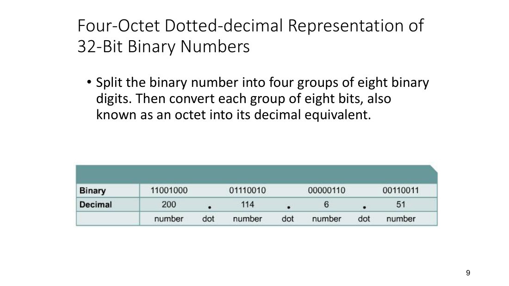
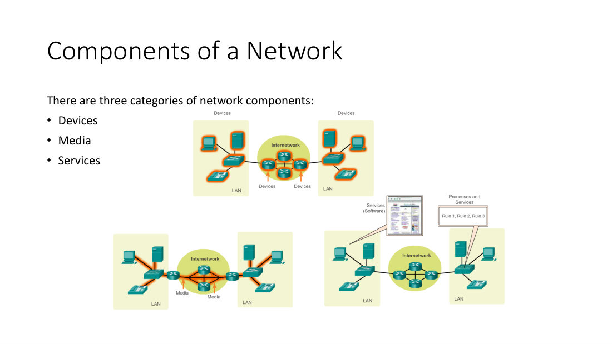
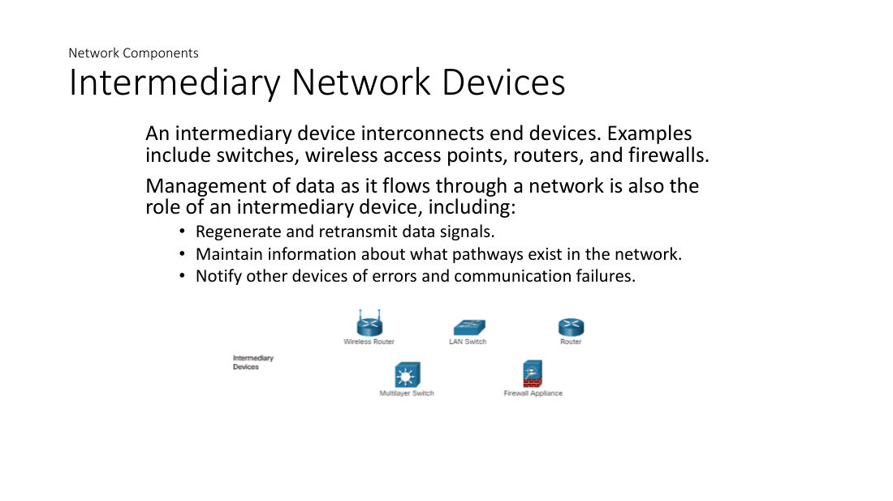
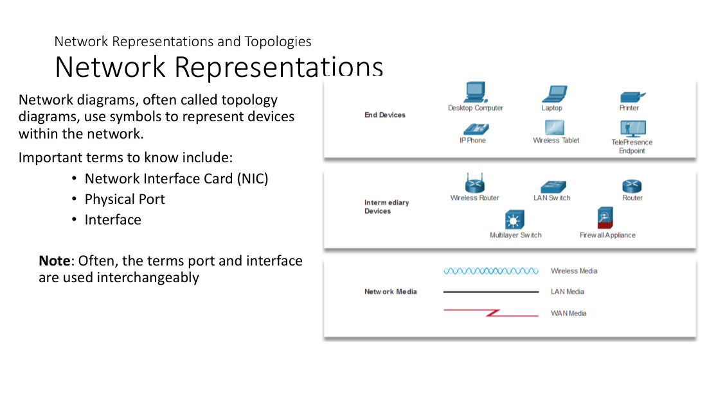
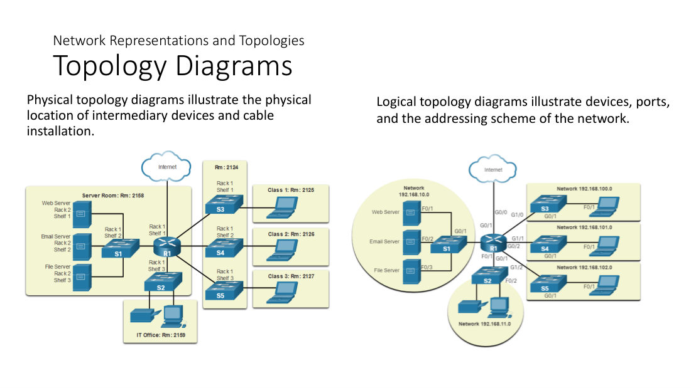
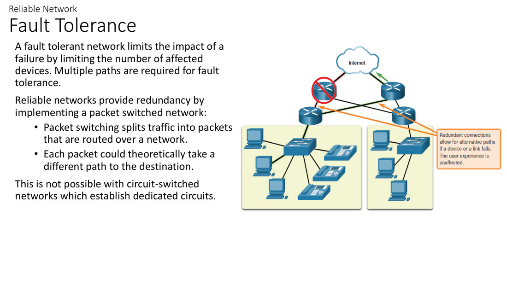
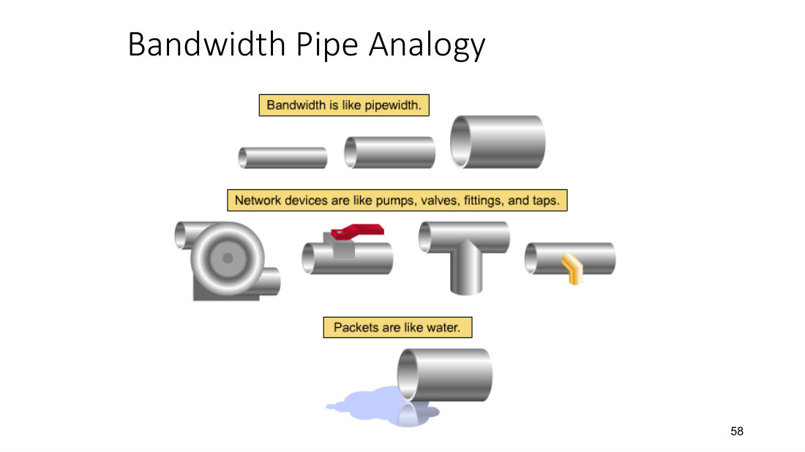
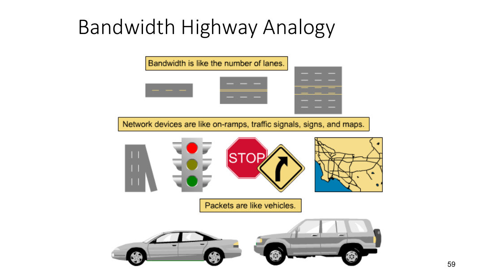

# Module 1：Exploring the Network（探索網絡）

> **Midterm Study Guide 列明 Module 1 考：**
> 1. **Components of a network**
> 2. **Common Types of networks**
> 3. **Reliable Networks**
>
> 其餘內容（Number Systems、Internet Connections、Network Trends、Security、Bandwidth）屬背景知識，但 Review Questions 有考 **bandwidth 單位**，所以都要識。

---

## 0. 教授上堂講過嘅重點（錄音整理）

- 🗣️ Network 存在嘅目的：**exchange information** —— **sending** 同 **receiving** data。
- 🗣️ 寄 email（相片）例子：相片 → 轉成 **bits（1s and 0s）** → 經 **NIC (Network Interface Card)** 離開電腦 → 經過 network devices → **UST email server**（因為 domain 係 ust.hk）→ …… → **Gmail email server** → 對方開 email app 下載 → 經對方 NIC 入電腦 → 顯示**同一張相（同一串 1s and 0s）**。
  - 兩個核心過程：**Encapsulation**（將 data 轉成 1s and 0s，Module 2 講）同 **Path determination**（搵路，靠 **IP address**，好似寄信要寫地址）。
- 🗣️ **NIC** 有 **wired NIC** 同 **wireless NIC**；所有 data 進出都經 NIC。
- 🗣️ 1s and 0s 會轉成乜嘢 signal **取決於 NIC 接咗乜嘢 media**：
  - copper cable → **electrical current（電流）**
  - fiber-optic cable → **light（光）**
  - wireless → **waves（電磁波）**
- 🗣️ **Router 係最重要嘅 network device**（"magic device"，冇佢就冇 Internet）；**Switch 係第二重要**。
- 🗣️ 教授明確講：**數字轉換（binary / decimal / hex conversion）唔會喺考試考**，只係基本技能。但係要明白 **IPv4 = 32 bits、4 octets、每個 octet 0–255**（教授話 "four-octet dotted-decimal" 呢版係「成個 chapter 最重要嘅 slide」）。

---

## 1. Number Systems & Computing Measurement（背景知識）

### 1.1 Bit 同 Byte
| Unit | 定義 | 例子 |
|---|---|---|
| **Bit (b)** | **Binary digit**，0 或 1 | On/Off；+5V / 0V |
| **Byte (B)** | 通常 = **8 bits** | 一個 ASCII 字元，例如 "X" |
| Kilobyte (KB) | 1 KB = 1024 bytes（約 1000 bytes / 8,000 bits） | 一封 email ≈ 2 KB |
| Megabyte (MB) | 1 MB = 1024 KB = 1,048,576 bytes | Floppy disk = 1.44 MB |
| Gigabyte (GB) | 1 GB = 1024 MB | 硬碟容量 |
| Terabyte (TB) | 1 TB = 1024 GB | |

- **Bits** 喺電腦入面以 On/Off 開關、電脈衝 (electrical impulses)、光脈衝 (light pulses) 或電磁波 (electromagnetic waves) 嘅有無表示。

> 🎯 **大 B vs 細 b（教授特別講）**
> - **大 B = Byte** → 用嚟講 **size / capacity（容量、檔案大小）**：例如 hard disk 512 **GB**、相片 3 **MB**。
> - **細 b = bit** → 用嚟講 **speed / bandwidth（速度、頻寬）**：例如 100 **Mbps**、1 **Gbps**（bits per second）。

### 1.2 三種進制
| | Base | Symbols | 原因 (Rationale) |
|---|---|---|---|
| **Decimal（十進制）** | Base 10 | 0–9（10 個） | 人有 10 隻手指 |
| **Binary（二進制）** | Base 2 | 0, 1（2 個） | **Two-state voltage systems** 用 transistors 做，便宜、細、抗 noise |
| **Hexadecimal（十六進制, hex）** | Base 16 | 0–9, A–F（A=10 … F=15） | 用更易讀嘅方式表示 binary；**每個 hex digit = 4 bits** |

- 8-bit 位值：**128, 64, 32, 16, 8, 4, 2, 1**（2⁷ … 2⁰）。
- 例：11101011₂ = 128+64+32+8+2+1 = **235**；11000101₂ = **197**；01110000₂ = **112**。
- Decimal → Binary：由最大位值開始減（或不斷除 2，**由下而上**讀餘數）。例：207 = 11001111。
- Binary ↔ Hex：由右邊開始每 **4 bits** 一組。例：0010 0001 0000 0010 = **0x2102**。
- **n bits 有 2ⁿ 種組合**：8 bits → 2⁸ = 256 種（0–255）。

### 1.3 IPv4 Dotted-Decimal（教授：最重要嘅 slide ⭐）
- **IPv4 address = 32-bit binary number**。
- 分成 **4 組，每組 8 bits = 1 個 octet**，每個 octet 轉成 decimal，中間用 **dot** 分隔 → **dotted-decimal format**。
- 例：11001000.01110010.00000110.00110011 = **200.114.6.51**。

- 每個 octet 範圍 **0 – 255**（全 0 = 0；全 1 = 255）。
- **IPv6 = 128 bits**，用 **hexadecimal** 表示（唔係 decimal）。
- 🗣️ 功課：用 Wi-Fi on / Wi-Fi off 查手機同電腦嘅 **IP address** 同 **MAC address**，同用 **OFCA** app 測網速。

---

## 2. ⭐ Components of a Network（必考）

網絡有 **三大類 components**：
1. **Devices**（裝置）
2. **Media**（傳輸媒介）
3. **Services**（服務 / 軟件、processes）

### 2.1 Host Roles：Server vs Client
- 網絡上每部電腦都叫 **host** 或 **end device**。
- **Servers**：**provide information to end devices** 嘅電腦，例如 **email server、web server、file server**。
- **Clients**：**send requests to the servers to retrieve information** 嘅電腦，例如向 web server 拎網頁、向 email server 拎 email。

| Server Type | Description |
|---|---|
| **Email** | Email server 行 email server software；Clients 用 client software 存取 email |
| **Web** | Web server 行 web server software；Clients 用 **browser software** 存取網頁 |
| **File** | File server 儲存公司同用戶檔案；client devices 存取呢啲檔案 |

### 2.2 Peer-to-Peer (P2P) Network
- 一部 device 可以**同時做 client 同 server**。**只建議用於 very small networks**。

| Advantages（優點） | Disadvantages（缺點） |
|---|---|
| **Easy to set up** | **No centralized administration** |
| **Less complex** | **Not as secure** |
| **Lower cost** | **Not scalable** |
| 用於簡單工作：**transferring files、sharing printers** | **Slower performance** |

### 2.3 End Devices（終端裝置）
- **An end device is where a message originates from or where it is received.**
- Data **originates with an end device, flows through the network, and arrives at an end device**。
- 🗣️ 教授：end devices = 我哋**直接互動 (directly interact)** 嘅裝置 —— computer、laptop、printer、IP phone、web camera、microphone、headphones、tablet。
- 圖中重點："**Messages can take alternate routes**"（訊息可以行其他路線）。

### 2.4 Intermediary Network Devices（中介網絡裝置）
- **An intermediary device interconnects end devices.** 例子：**switches、wireless access points、routers、firewalls**（仲有 multilayer switch、wireless router、firewall appliance）。
- 中介裝置管理 data flow 嘅角色（**要背三點**）：
  1. **Regenerate and retransmit data signals**（再生同重新傳送訊號）
  2. **Maintain information about what pathways exist in the network**（記錄網絡有咩路徑）
  3. **Notify other devices of errors and communication failures**（通知其他裝置錯誤同通訊失敗）

### 2.5 Network Media（媒介）
**Communication across a network is carried through a medium which allows a message to travel from source to destination.**

| Media Types | 訊號形式 |
|---|---|
| **Metal wires within cables**（copper：twisted-pair、coaxial） | **Electrical impulses**（電脈衝） |
| **Glass or plastic fibers within cables (fiber-optic cable)** | **Pulses of light**（光脈衝） |
| **Wireless transmission** | **Modulation of specific frequencies of electromagnetic waves** |

- Common network media：**twisted-pair、coaxial、fiber-optic cable、atmosphere（wireless）**。
- 🗣️ 教授講嘅四種 media 例子：
  - **Twisted pair**：Wi-Fi router 駁去牆嗰條線（Lab 1 自己整）
  - **Coaxial**：電視天線嗰條圓頭白色線
  - **Optical fiber**：入面係 **glass / plastic**，傳 **light**
  - **Wireless**：冇線，經 atmosphere 傳 waves
- 🗣️ **最快 = Optical fiber**（光比電流快）；跨洲 / 跨國主要靠**海底光纖 (undersea optical fiber cables)**。
- 🗣️ 家居少用光纖：**貴 + glass/plastic 易斷 (fragile)**。
- 🗣️ **最唔安全 = Wireless**（任何人都可以用 **Wireshark** capture）；**最安全 = Optical fiber**（copper 可以 **wiretap**，光纖做唔到）。

### 2.6 Network Representations（網絡圖示）
- **Network diagrams**（又叫 **topology diagrams**）用 **symbols** 代表網絡裝置。
- 要識嘅 terms：
  - **Network Interface Card (NIC)**：令 device 連接網絡嘅卡（wired / wireless）
  - **Physical Port**：裝置上插線嘅位（connector / outlet）
  - **Interface**：裝置上連接特定網絡嘅專門 port
  - ⚠️ **Port 同 interface 通常可以互換使用 (used interchangeably)**。
- 🗣️ Lab 入面 router 背後 port 有名：**F**（FastEthernet）、**S**（Serial）等等。
- 三類符號：**End Devices**、**Intermediary Devices**、**Network Media**（Wireless media = 波浪線；LAN media = 直線；**WAN media = 閃電 Z 字線**）。

### 2.7 Topology Diagrams
| | 顯示乜嘢 |
|---|---|
| **Physical topology diagram** | **Physical location of intermediary devices and cable installation**（裝置實際位置、房間、rack、線點樣行） |
| **Logical topology diagram** | **Devices, ports, and the addressing scheme of the network**（裝置、port 名、IP addressing） |

- 🗣️ 教授：Physical = **how things are physically connected**；Logical = **how data moves**（要用 IP / network address）。

---

## 3. ⭐ Common Types of Networks（必考）

### 3.1 Networks of Many Sizes
| 類型 | 描述 |
|---|---|
| **Small Home Networks** | 將幾部電腦互相連接同接駁 Internet |
| **Small Office/Home Office (SOHO)** | 令屋企或 remote office 嘅電腦連接 **corporate network** |
| **Medium to Large Networks** | 多個地點，有幾百至幾千部互連電腦 |
| **World Wide Networks** | 連接全球幾億部電腦，例如 **the Internet** |

### 3.2 LAN vs WAN
Network infrastructures 嘅分別在於：**size of the area covered、number of users connected、number and types of services available、area of responsibility**。

| **LAN (Local Area Network)** | **WAN (Wide Area Network)** |
|---|---|
| **Spans a small geographical area** | **Spans a wide geographical area** |
| **Interconnect end devices in a limited area** | **Interconnect LANs over wide geographical areas** |
| **Administered by a single organization or individual** | **Typically administered by one or more service providers** |
| **Provide high-speed bandwidth to internal devices** | **Typically provide slower speed links between LANs** |

- 🗣️ 例子：屋企網絡、HKUST、HSBC 香港辦公室 = LAN；HSBC Hong Kong LAN 連 HSBC UK LAN = WAN。
- ⚠️ 陷阱：**WAN 一般由 service provider 管理、速度較慢**；LAN 由單一機構管理、速度高。

### 3.3 其他網絡類型
| 類型 | 說明 / 教授例子 |
|---|---|
| **MAN (Metropolitan Area Network)** | 覆蓋一個城市 / 都會區（例如 London、Paris 嘅城市網絡） |
| **WLAN (Wireless LAN)** | 無線 LAN，例如 UST 嘅 **eduroam** |
| **SAN (Storage Area Network)** | 大量儲存裝置 / database servers 連埋一齊，例如 Google Cloud、AWS、Alibaba Cloud |

- 🗣️ **WLAN 細節**：Wireless router 又叫 **AP (Access Point)**；每個 AP 有名 = **SSID (Service Set Identifier)**；AP 會發出 **beacons** 廣播 SSID（所以手機見到附近 Wi-Fi 列表）；高保安地方可以 **disable beacon（隱藏 SSID）**，用戶要自己手動加網絡。大範圍 WLAN 要有**多個 AP、覆蓋範圍要重疊 (overlap)、用同一個 SSID**，用戶先可以 **roam**（行嚟行去切換 AP 時可能短暫斷線）。

### 3.4 The Internet
- **The internet is a worldwide collection of interconnected LANs and WANs.**
- **LANs are connected to each other using WANs.**
- WANs 可以用 **copper wires、fiber optic cables、wireless transmissions**。
- **The internet is not owned by any individual or group.** 維持結構嘅組織：
  - **IETF** – Internet Engineering Task Force
  - **ICANN** – Internet Corporation for Assigned Names and Numbers
  - **IAB** – Internet Architecture Board
- 🗣️ **Internet vs WWW**：Internet = 互連嘅網絡本身 (**interconnected networks**)；**WWW (World Wide Web)** = 用 browser、經 **HTTP/HTTPS** 存取 Internet 上嘅資訊。
  - **URL** = Uniform Resource Locator（browser 打網址嗰格）
  - **HTTP** = HyperText Transfer Protocol（傳網頁嘅 protocol）
  - **HTML** = HyperText Markup Language（寫網頁嘅語言）

### 3.5 Intranets and Extranets
- **Intranet**：**a private collection of LANs and WANs internal to an organization** that is meant to be **accessible only to the organization's members or others with authorization**。
- **Extranet**：機構用嚟 **provide secure access to their network for individuals who work for a different organization** that need access to their data（例如 suppliers、customers、partners）。
- 🗣️ 教授例子：Peter 喺 HSBC 返工，用公司俾嘅 username/password 登入 **intranet**，因工作需要可以睇其他客戶資料；但 Peter 用自己 **e-banking** 時只可以睇自己嘅帳戶（外部人士有限度存取 = **extranet** 概念）。

---

## 4. Internet Connections（背景知識）

- 家居 / 小型辦公室常用：**broadband cable、broadband DSL、wireless WANs、mobile services**。
- 機構需要更快連線支援 **IP phones、video conferencing、data center storage**；Business-class 由 **service providers (SP)** 提供：**business DSL、leased lines、Metro Ethernet**。

### 4.1 Home and Small Office Internet Connections
| Connection | Description |
|---|---|
| **Cable** | **High bandwidth, always on**，由 **cable television service providers** 提供（🗣️ 例如 Now TV） |
| **DSL** | **High bandwidth, always on**，經 **telephone line** 運行 |
| **Cellular** | 用 **cell phone network** 上網 |
| **Satellite** | 對冇 ISP 嘅 **rural areas** 有大好處 |
| **Dial-up telephone** | **Inexpensive, low bandwidth**，用 **modem** |

- 🗣️ **DSL = Digital Subscriber Line**。家用多數係 **ADSL（Asymmetric：download 快過 upload）**；企業用 **SDSL（Symmetric：upload = download 速度）**。
- 🗣️ **Satellite** 缺點：用 waves（慢過光纖嘅光）+ 受天氣 / 大氣影響（打雷落雨會中斷）→ 所以跨國主要靠海底光纖。
- 🗣️ 晚上 7–9 點網速慢：成棟大廈 **share** 同一條連線 → 每人分到嘅 **throughput** 減少。企業會用 **dedicated** 連線避免。

### 4.2 Businesses Internet Connections
企業需要：**higher bandwidth、dedicated connections、managed services**。

| Type | Description |
|---|---|
| **Dedicated Leased Line** | **Reserved circuits within the service provider's network** that connect distant offices with private voice and/or data networking |
| **Ethernet WAN** | **Extends LAN access technology into the WAN** |
| **DSL** | Business DSL 有多種格式，包括 **SDSL (Symmetric DSL)** |
| **Satellite** | 冇 wired solution 時可以提供連線 |

---

## 5. ⭐ Reliable Networks（必考）

**Network Architecture** = 支援把 data 喺網絡上移動嘅 infrastructure 技術。底層 architecture 要滿足用戶期望，有 **四個基本特性 (four basic characteristics)**：

> 🧠 記法：**F-S-Q-S** → **Fault Tolerance、Scalability、QoS、Security**

### 5.1 Fault Tolerance（容錯）
- **A fault tolerant network limits the impact of a failure by limiting the number of affected devices.**
- **Multiple paths are required for fault tolerance.**（要有多條路徑 / **redundancy**）
- Reliable networks provide redundancy by implementing a **packet-switched network**：
  - **Packet switching splits traffic into packets that are routed over a network.**
  - **Each packet could theoretically take a different path to the destination.**
- ⚠️ **Circuit-switched networks** 建立 **dedicated circuits**，所以**做唔到**上述效果。
- 圖：**Redundant connections allow for alternative paths if a device or a link fails. The user experience is unaffected.**

- 🗣️ 教授：preferred path 斷咗，就經 alternate route 送 data —— 靠 **routing**（routing protocols 例如 **RIP、EIGRP、OSPF**，3180 唔教 config，ISOM 3380 先教）。

### 5.2 Scalability（可擴展性）
- **A scalable network can expand quickly and easily to support new users and applications without impacting the performance of services to existing users.**
- **Network designers follow accepted standards and protocols in order to make the networks scalable.**
- 🗣️ 例子：選科 (course registration) 頭幾日好慢 —— 好多用戶同時用同一個 server；要為 **future growth** 預留 bandwidth。

### 5.3 Quality of Service (QoS)
- **Voice and live video transmissions require higher expectations** for those services being delivered.
- 睇 live video 斷斷續續 = **demand for bandwidth > available**，而且**冇設定 QoS**。
- **QoS is the primary mechanism used to ensure reliable delivery of content for all users.**
- **With a QoS policy in place, the router can more easily manage the flow of data and voice traffic.**
- 🗣️ 教授：**time-sensitive applications**（audio/video streaming、VoIP、WhatsApp call）要俾 **priority**；普通瀏覽網頁可以較低 priority。冇 QoS 就係 **round robin**（輪流，每人一樣）。

### 5.4 Network Security
兩大類 network security：
1. **Network infrastructure security**
   - **Physical security of network devices**
   - **Preventing unauthorized access to the devices**
2. **Information Security**
   - **Protection of the information or data transmitted over the network**

**Three goals of network security —— CIA：**
| Goal | 定義 |
|---|---|
| **Confidentiality** | **Only intended recipients can read the data**（只有預期收件人可以讀） |
| **Integrity** | **Assurance that the data has not been altered with during transmission**（傳送途中冇被改） |
| **Availability** | **Assurance of timely and reliable access to data for authorized users**（授權用戶可以及時可靠咁存取） |

- 🗣️ 偷 data 兩種方法：**physical**（直接拎部機）vs **logical**（remote hack）。

---

## 6. Network Trends（背景知識）

- **BYOD (Bring Your Own Device)**：**any device, with any ownership, used anywhere**；用自己 laptops、netbooks、tablets、smartphones、e-readers。
  - 🗣️ 風險：公司敏感資料喺私人裝置，**遺失 / 被偷 → data leakage**（教授舉咗有人拎 laptop 去維修、私人資料被外洩嘅真實例子）。對策：**encrypt data**（例如醫管局只認加密 USB）、**remote wipe**、locate phone。
- **Cloud Computing**：經 Internet 喺 servers 儲存 / backup 檔案、存取 applications；靠 **data centers** 實現；細公司可以向大型 data center 租 server / storage。
  - **Four types of Clouds**：
    - **Public Clouds** – 經 **pay-per-use** 或免費提供俾公眾
    - **Private Clouds** – 俾特定機構（例如政府）
    - **Hybrid Clouds** – **兩種或以上 cloud** 組成（例如 part custom, part public），各部分保持獨立但用同一 architecture 連接
    - **Custom Clouds** – 為特定行業（如 healthcare、media）而建，可以係 private 或 public
- **Smart home technology / IoT (Internet of Things)**：家電互相連接（焗爐睇你日曆決定幾時煮；Tesla 遙距開冷氣；intelligent refrigerator 自動落單買牛奶）。
- **Powerline Networking**：用 **standard powerline adapter**，喺有 **electrical outlet** 嘅地方經電線傳 data（用特定頻率）；適合 **wireless access points 覆蓋唔到** 嘅地方。🗣️ 大屋 / 村屋亦可用 **repeater**（regenerate 訊號）或 **mesh network**。
- **Wireless Broadband**：
  - **WISP (Wireless Internet Service Provider)**：多數喺 **rural** 環境，連接用戶到指定 access points / hotspots。
  - 用同手機一樣嘅 **cellular technology**；屋外裝 antenna。

---

## 7. Network Security（背景知識）

- Network security 係任何規模網絡嘅 **integral part**；**threat vectors might be external or internal**。

| **External Threats** | **Internal Threats** |
|---|---|
| **Viruses, worms, and Trojan horses** | **Lost or stolen devices** |
| **Spyware and adware** | **Accidental misuse by employees** |
| **Zero-day attacks** | **Malicious employees** |
| **Threat Actor attacks** | |
| **Denial of service (DoS) attacks** | |
| **Data interception and theft** | |
| **Identity theft** | |

- 🗣️ **Zero-day attack**：新病毒出現嗰日，antivirus 資料庫仲未有 → antivirus 只識防 **known viruses**，所以要每日 update（例如 Windows Defender）。
- 🗣️ **DoS / DDoS**：同一時間送大量 requests 令 server crash（TVB 選美投票 server 冚檔例子）；而家用 **queueing system** 限制同時用戶。
- 🗣️ **Ransomware**：例如 **WannaCry** —— encrypt 成個 hard disk 要求付 Bitcoin；對策：經常 backup。
- 🗣️ Internal threats 分兩類：**unintentional**（lost/stolen devices、accidental misuse）vs **intentional**（malicious employees）。大部分威脅來自**人為 (human)**。

**Security Solutions** —— **Security must be implemented in multiple layers using more than one security solution.**
- Home / small office：**Antivirus and antispyware**（裝喺 end devices）、**Firewall filtering**（block unauthorized access）。
- Larger networks 額外要：**Dedicated firewall system、Access control lists (ACL)、Intrusion prevention systems (IPS)、Virtual private networks (VPN)**。
  - 🗣️ **ACL**：喺 router 設定，例如只有 HR 可以入 HR server、學生唔可以入 exam server（ISOM 3380 教）。
  - 🗣️ **VPN**：經 public Internet **安全地遙距存取公司資料**。
- 🗣️ **Authentication 三類**：**Something you know**（username/password）、**Something you are**（指紋、Face ID）、**Something you have**（ID card、手機）；進階：**OTP**、**push notification**（UST 2FA）、**behavioral authentication**（打字力度、拎手機角度）。

---

## 8. Bandwidth（Review Q14 有考 ⭐）

- **Bandwidth is defined as the amount of information that can flow through a network connection in a given period of time.**
- 單位用 **細 b（bits per second, bps）**：**kbps、Mbps、Gbps**（亦有 Tbps）。
  - ⚠️ 陷阱：**GHzps、Nbps、MHzps 都係假單位！** Hz 係頻率單位，唔係 bandwidth。
- **Bandwidth Pipe Analogy（水管比喻）**：
  - **Bandwidth is like pipe width**（水管闊度）
  - **Network devices are like pumps, valves, fittings, and taps**
  - **Packets are like water**

- **Bandwidth Highway Analogy（公路比喻）**：
  - **Bandwidth is like the number of lanes**（行車線數目）
  - **Network devices are like on-ramps, traffic signals, signs, and maps**
  - **Packets are like vehicles**

- 🗣️ **Throughput**：實際得到嘅速度；多人 share 同一條線時 throughput 會跌。

---

## ✅ Module 1 快速自測

1. 網絡三大 components？→ **Devices, Media, Services**
2. Intermediary devices 三個 data-flow 管理角色？→ **Regenerate & retransmit signals；maintain pathway info；notify errors & failures**
3. P2P 嘅缺點？→ **No centralized administration、not as secure、not scalable、slower performance**
4. LAN vs WAN 邊個通常由 service provider 管理？→ **WAN**
5. 容錯靠咩？→ **Redundancy / multiple paths；packet-switched network**
6. CIA 係乜？→ **Confidentiality, Integrity, Availability**
7. 邊啲係 bandwidth 單位？→ **kbps, Mbps, Gbps**（唔係 GHzps / MHzps / Nbps）
8. 最安全 / 最快嘅 media？→ **Optical fiber**；最唔安全 → **Wireless**
