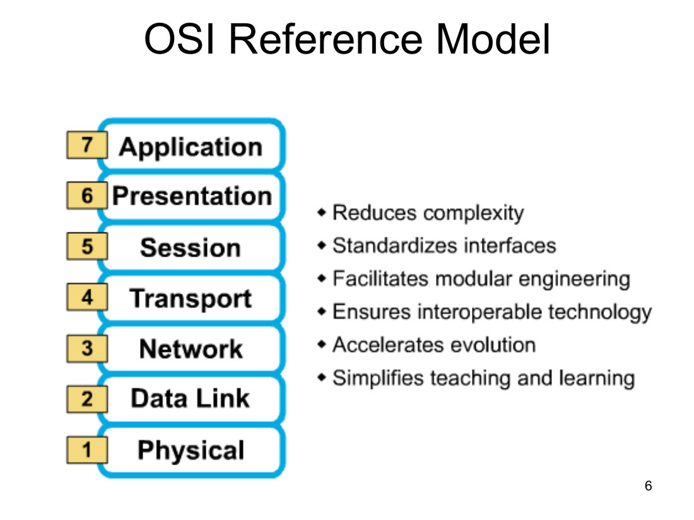
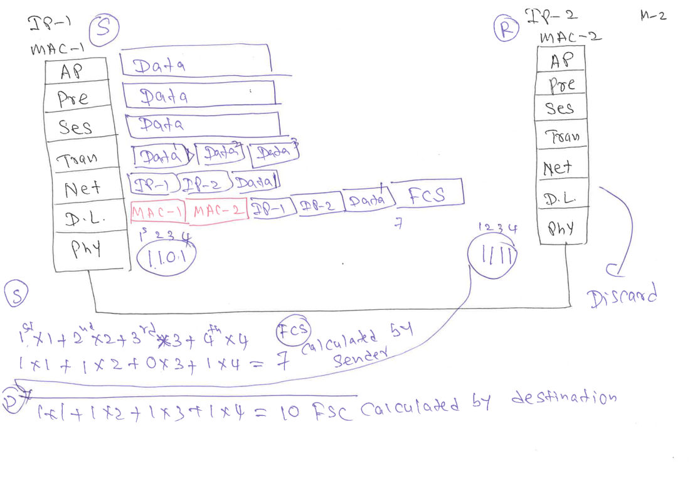
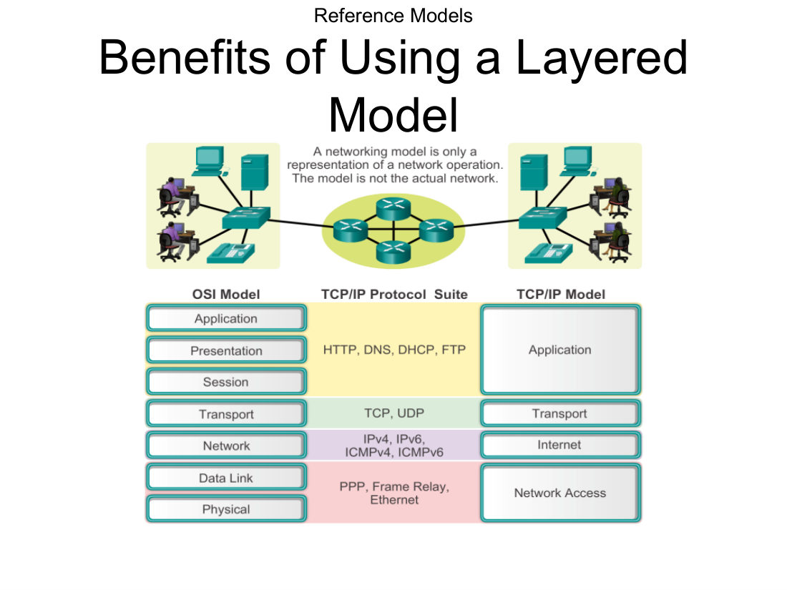
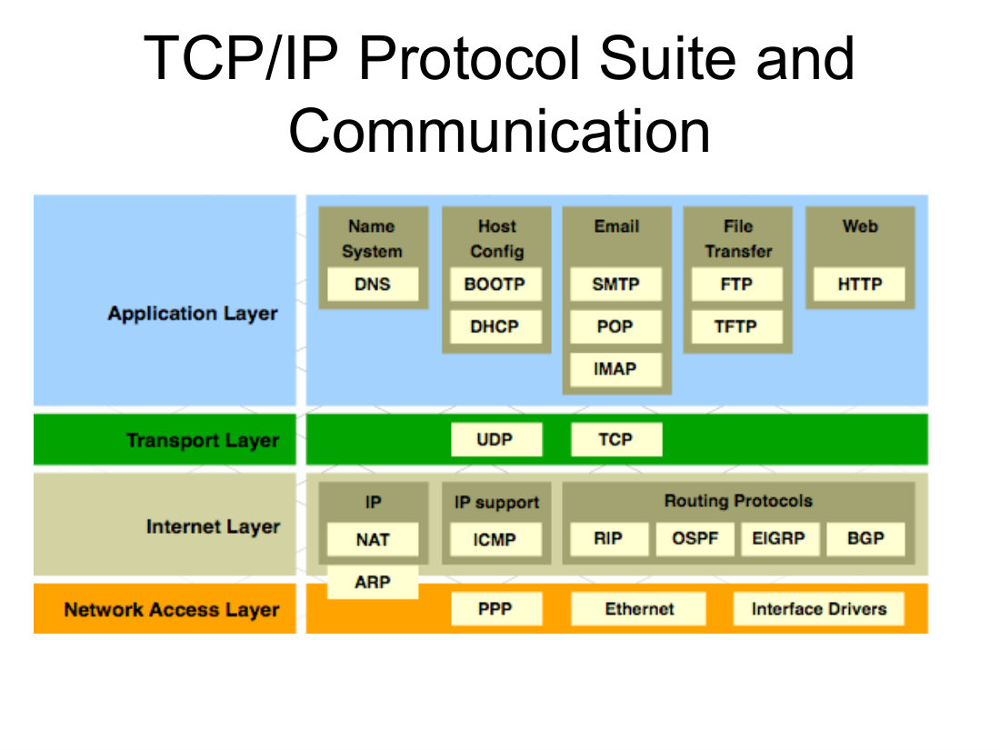
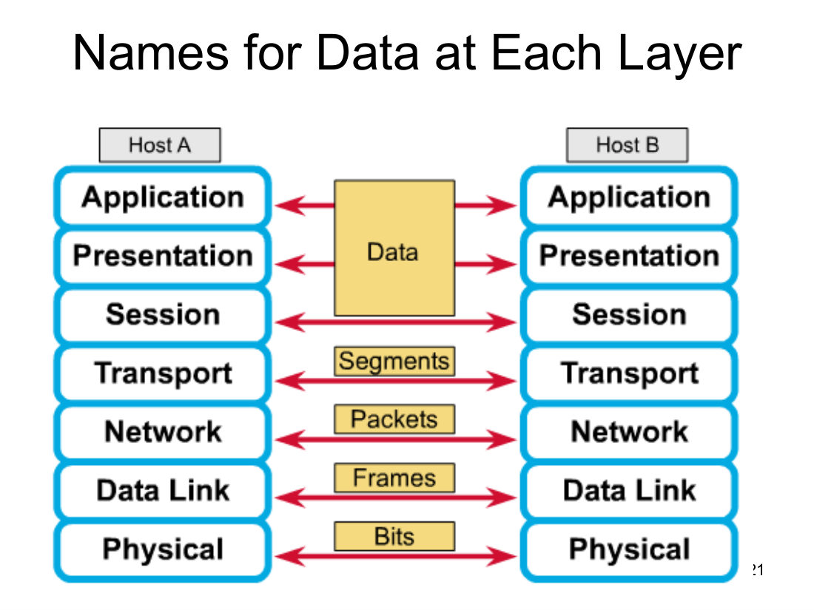
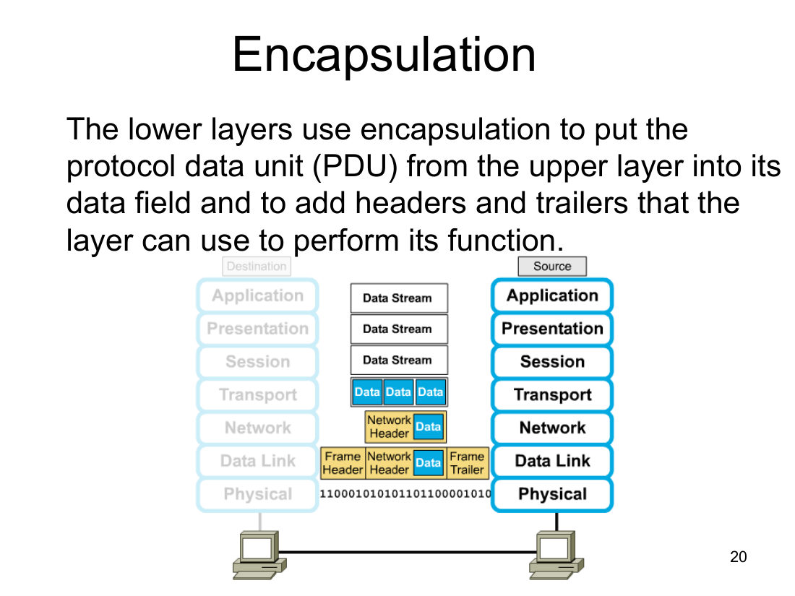
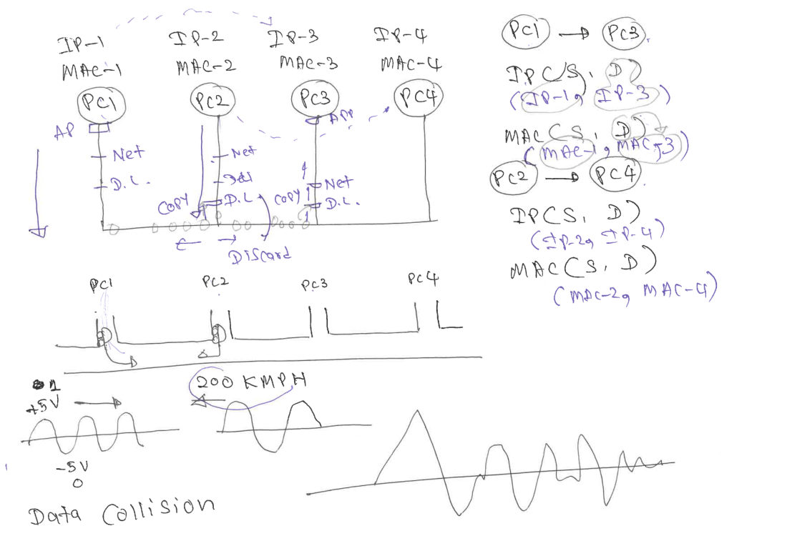
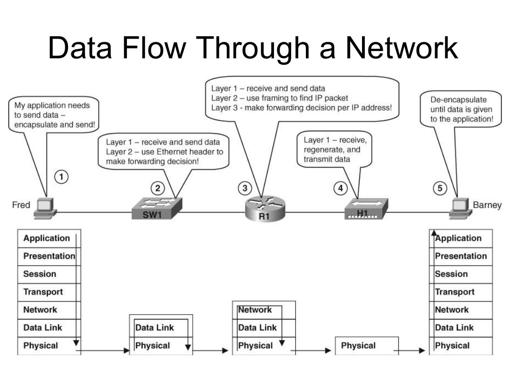

# Module 2：Protocols and Communications（協定與通訊）

> **Midterm Study Guide 列明 Module 2 考：**
> 1. **OSI Model：Function of Each Layer**（每層嘅功能）
> 2. **Encapsulation and De-Encapsulation**（封裝與解封裝）
>
> 🗣️ 教授 revision（20 Oct）：「Module 2 我哋講兩樣嘢：**OSI model** 同 **encapsulation / de-encapsulation**，呢兩樣就係你 midterm 要識嘅。」

---

## 1. Network Protocols（網絡協定）

- **Communication must follow a set of rules.**（通訊要跟一套規則）
- **Networking rules are defined by a set of standards and protocols.**
- **A single standard or protocol defines what a small part of the network does.**
- **The TCP/IP (Transmission Control Protocol/Internet Protocol) suite** 定義咗一大套用嚟連接電腦嘅 standards 同 protocols。
- 🗣️ 教授：**Protocols make communication more efficient and effective.**（課堂最重要 protocol =「老師講書時唔好傾偈」😂；用同一種語言溝通都係 protocol）

### 1.1 The Need for Protocols and Standards
- **1960s to 1980s – each vendor set its own proprietary protocols and standards** → **equipment from different vendors would not interoperate**（唔同牌子設備唔可以一齊用 = 冇 **interoperability**）。
- 最後大家同意用 **open standards**。
- **Open standards allow more competition, which increases speed of development.**

### 1.2 Using Layers to Describe Data Communication
- Data communication 好複雜，好難一次過理解。
- 解決方法：**break down the total network communication system into a series of layers**。
- **Each layer is responsible for a specific part of network communication.**
- **These layers interact with the layer above and below.**
- 兩個常用分層模型：**OSI (Open System Interconnection) reference model** 同 **TCP/IP reference model**。

### 1.3 History：Creation of Internet, Development of TCP/IP
| 年份 | 事件 |
|---|---|
| **1969** | **ARPANET**（Advanced Research Projects Agency Network）誕生 —— **first packet switching network**，今日 Internet 嘅前身；連接**四個地點**嘅 mainframe computers；由 **U.S. Department of Defense** 資助，俾大學同研究所用 |
| | **BBN (Bolt, Beranek and Newman)** 係承辦商，整咗**第一部 router —— IMP (Interface Message Processor)** |
| **1973** | **Robert Kahn** 同 **Vinton Cerf** 開始研發 **TCP**，取代 ARPANET 原本嘅 **NCP (Network Control Program)** |
| **1978** | **TCP 拆成兩個 protocols：TCP 同 IP**；之後加入 Telnet、FTP、DNS 等等 |

---

## 2. ⭐ OSI Reference Model（必考：每層功能）

### 2.1 七層 + 記憶口訣
| Layer | Name | 一句記住 |
|---|---|---|
| 7 | **Application** | **Network process to applications**（user interface） |
| 6 | **Presentation** | **Data representation**（format / compression / encryption） |
| 5 | **Session** | **Interhost communication**（建立、管理、終止 session） |
| 4 | **Transport** | **End-to-end connection**（reliability：TCP / UDP；segments） |
| 3 | **Network** | **Address and best path**（logical address = IP；path determination） |
| 2 | **Data Link** | **Access to media**（physical address = MAC；error detection = FCS） |
| 1 | **Physical** | **Binary transmission**（moves bits） |

> 🧠 **教授口訣（由下而上，Layer 1→7）**：**P**lease **D**o **N**ot **T**hrow **S**ausage **P**izza **A**way
> → **P**hysical, **D**ata Link, **N**etwork, **T**ransport, **S**ession, **P**resentation, **A**pplication
>
> 🧠 **由上而下（Layer 7→1）**：**A**ll **P**eople **S**eem **T**o **N**eed **D**ata **P**rocessing




**OSI model 嘅好處（slide 6）：**
- **Reduces complexity**
- **Standardizes interfaces**
- **Facilitates modular engineering**
- **Ensures interoperable technology**
- **Accelerates evolution**
- **Simplifies teaching and learning**

> 🗣️ **教授：最重要嘅三層** —— ① **Network layer**（最重要）② **Transport layer** ③ **Data Link layer**。

### 2.2 每層功能詳解

#### Layer 7 – Application Layer：Network Process to Applications
- **Provides network services to the user's application.**
- **User interface**（🗣️ 用戶第一個接觸網絡嘅地方）
- Examples：**Telnet、HTTP、Web browsers**
- 🗣️ 教授：network applications 例如 **Canvas、Facebook**；**web browser 係最廣泛使用嘅 network application**。

#### Layer 6 – Presentation Layer：Data Representation
- **Ensures that the information that the application layer of one system sends out is readable by the application layer of another system.**
- **How data is presented.**
- **Special processing, such as data format, compression and encryption.**
- 🗣️ 三樣嘢：**data format**（audio/video/text 格式）、**data compression**（例如寄成個學期 notes 前先 zip）、**data encryption**。
- 🗣️ Encryption 例子（M2 Supplementary）："I miss you" 用 code 變成 **1 2133 456** 寄出（**code / encode**），對方用同一個 key **decode** 返 "I miss you"；中途俾人截咗都睇唔明。

#### Layer 5 – Session Layer：Interhost Communication
- **Establishes, manages, and terminates sessions between two communicating hosts.**
- 🗣️ 教授：「Session layer 我哋唔使理太多。」

#### Layer 4 – Transport Layer：End-to-End Connection ⭐（第二重要）
- **How reliable transport between two hosts is accomplished is the concern of the transport layer.**
- **Reliable or unreliable delivery.** Examples：**TCP、UDP**。
- **TCP breaks large data into segments.**
- **TCP marks each data packet with a sequence number.**
- **A missing packet can be resent.**

🗣️ **Reliability = Error detection + Error correction：**

| 機制 | Transport layer 點做 | 對象 |
|---|---|---|
| **Error detection** | **Acknowledgement (ACK)**：receiver 收到後回覆 | **只對 sender 有用**（sender 等 ACK；receiver 根本唔知 sender 有冇寄過） |
| **Error correction** | **Retransmission**：等唔到 ACK（timer expires）就重寄 | sender 重寄 |

| **TCP** | **UDP** |
|---|---|
| **Reliable** | **Unreliable** |
| 有 **error detection + error correction**（ACK + retransmission） | **冇 error detection、冇 error correction** |
| 要等 ACK → **較慢** | 唔使等 → **較快** |
| 用於 reliability 重要嘅應用（例如 email、web、file transfer） | 用於 **time-sensitive applications**：**audio streaming、video streaming** |

- 🗣️ 寄信例子：講故事分幾封信寄 —— 要等收到第 1 封嘅 ACK 先寄第 2 封，否則對方可能只收到第 2 封睇唔明 → 可靠但慢（TCP）。睇 online movie 唔可以每格畫面都等 ACK → 用 UDP。
- 🗣️ **Transport layer 做兩件事**：① **reliability（TCP/UDP）** ② **large data break into smaller pieces → segments**（好似大疊文件分幾個信封寄）。

#### Layer 3 – Network Layer：Address and Best Path ⭐（最重要）
- **Provides connectivity and path selection between two host systems that may be located on geographically separated networks.**
- **Provides logical addressing which routers use for path determination.**
- Examples：**IP**。
- 🗣️ **Network layer 做兩件事**：① **Addressing（logical address = IP address）** ② **Best path（path determination）**。

🗣️ **Physical vs Logical Address（教授例子 ⭐）**

| | **Physical address** | **Logical address** |
|---|---|---|
| 教授例子 | **"Percy"**（去到邊都跟住佢） | **"Professor, HK, UST, ISOM"**（轉去 HKU 教就會變） |
| 網絡入面 | **MAC address**（喺 **NIC** 入面） | **IP address** |
| 位置改變時 | **唔變**（要換 NIC 先會變） | **會變**（屋企同 UST 嘅 IP 唔同） |
| 屬於邊層 | **Data Link (Layer 2)** | **Network (Layer 3)** |

- 🗣️ **Path determination 用 logical address**：英國嘅朋友想搵教授 —— 喺英國問人「Percy 喺邊」冇用；要先睇 **HK**（飛嚟香港）→ **UST**（搭的士入科大）→ **ISOM**（去系辦）→ 最後先搵 Percy。
  - IP address 有三部分：**network、subnet、host**（近 sender 睇 network 部分，中途睇 subnet，近目的地睇 host）。
  - ⚠️ 世界上可以有兩個 "Percy"，但 **MAC address 係 unique**，唔會重複。
- 🗣️ **Best path**：一齊去旺角食飯，大家都揀 "best path"，但 "best" 嘅定義可以唔同（教授 = 最平；學生 = 最快）。

#### Layer 2 – Data Link Layer：Access to Media ⭐（第三重要）
- **Concerned with physical (as opposed to logical) addressing.**
- **Access to media using MAC address.**
- **Error detection.**
- 🗣️ **Data Link layer 做兩件事**：① **Physical address（MAC）** ② **Error detection using FCS (Frame Check Sequence)**。
- ⚠️ **FCS 嘅 error detection 係俾 receiver 用**（transport layer 嘅 ACK 係俾 sender 用）。
- ⚠️⚠️ **Data Link layer 只有 error detection，冇 error correction！Error correction（retransmission）只喺 Transport layer 發生。**

🗣️ **FCS 點運作（M2 Supplementary 簡化例子）**：
- Sender 計 FCS：bits **1101** → 1×1 + 1×2 + 0×3 + 1×4 = **7**，將 7 放入 frame trailer。
- 傳送途中出錯，receiver 收到 **1111** → 自己計 1×1 + 1×2 + 1×3 + 1×4 = **10**。
- **10 ≠ 7 → FCS 唔 match → receiver discard（丟棄）個 frame**。



- Receiver **唔會**要求重寄（唔會 initiate retransmission）；係 **sender 等唔到 ACK、timer expires 後自己 retransmit**（Review Q10 ⭐）。

#### Layer 1 – Physical Layer：Binary Transmission
- **Moves bits between devices.**
- 🗣️ 將所有嘢轉成 **1s and 0s**（再按 media 變成電流 / 光 / 電磁波）。

---

## 3. TCP/IP Model vs OSI Model

| OSI Model | TCP/IP Protocol Suite（例子） | **TCP/IP Model** | 功能 |
|---|---|---|---|
| 7 Application / 6 Presentation / 5 Session | **HTTP, DNS, DHCP, FTP** | **Application** | **Represents data to the user**（加上 encoding 同 dialog control） |
| 4 Transport | **TCP, UDP** | **Transport** | **Supports communication between diverse devices across diverse networks** |
| 3 Network | **IPv4, IPv6, ICMPv4, ICMPv6** | **Internet** | **Determines the best path through the network** |
| 2 Data Link / 1 Physical | **PPP, Frame Relay, Ethernet** | **Network Access** | **Controls the hardware devices and media that make up the network** |

> 🎯 **TCP/IP model 四層：Application、Transport、Internet、Network Access**（Review Q13：選 **Application、Internet、Network Access**；**Physical、Presentation 唔係** TCP/IP model 嘅 layer）
>
> 🗣️ 記法：OSI 頭三層（Application + Presentation + Session）合併做 **Application**；Network 改名做 **Internet**；Data Link + Physical 合併做 **Network Access**。
>
> ⚠️ 教授 revision 時話 Q13 "not part of our study guide"，但都要識。




**TCP/IP Protocol Suite 分佈（slide 18）：**
| Layer | Protocols |
|---|---|
| **Application** | Name System：**DNS**；Host Config：**BOOTP、DHCP**；Email：**SMTP、POP、IMAP**；File Transfer：**FTP、TFTP**；Web：**HTTP** |
| **Transport** | **UDP、TCP** |
| **Internet** | **IP、NAT**；IP support：**ICMP**；Routing Protocols：**RIP、OSPF、EIGRP、BGP** |
| **Network Access** | **ARP**（喺 Internet / Network Access 之間）、**PPP、Ethernet、Interface Drivers** |




- **A networking model is only a representation of a network operation. The model is not the actual network.**
- 🗣️ 預告（期中唔考細節）：上網要 **4 個 address**：source IP、source MAC（喺自己 NIC）、destination IP、destination MAC。
  - 自己 IP 由 **DHCP server** 派；
  - Destination IP 由 **DNS server** 將 domain name（例如 www.facebook.com）轉成 IP；
  - Destination MAC 用 **ARP** 搵。

---

## 4. ⭐ Encapsulation（封裝）（必考）

**定義（要背）：** **The lower layers use encapsulation to put the protocol data unit (PDU) from the upper layer into its data field and to add headers and trailers that the layer can use to perform its function.**

### 4.1 PDU (Protocol Data Unit) —— Names for Data at Each Layer
| OSI Layer | **PDU 名** |
|---|---|
| Application / Presentation / Session (7/6/5) | **Data** |
| Transport (4) | **Segments** |
| Network (3) | **Packets** |
| Data Link (2) | **Frames** |
| Physical (1) | **Bits** |

> 🧠 **教授口訣**：**D**ozens **o**f **S**ausage **P**izza **F**ull **B**elly → **D**ata → **S**egment → **P**acket → **F**rame → **B**its（encapsulation 方向，由上而下）




### 4.2 Encapsulation 過程（Source / Sender，由 Layer 7 落去 Layer 1）
1. **Application / Presentation / Session**：產生 **data**（data stream）。
2. **Transport**：將大 data **斬細成 segments**（好似大疊文件分幾個信封）→ **Segment**。
3. **Network**：每個 segment 加上 **network header = source IP + destination IP**（好似喺信封寫地址）→ **Packet**。
4. **Data Link**：加上 **frame header = source MAC + destination MAC** 同 **frame trailer = FCS** → **Frame**。
5. **Physical**：全部轉成 **bits（1s and 0s）** 送出 media。

```
Data
[Data][Data][Data]                                  ← Transport：segments
[Net Hdr: IP-S, IP-D][Data]                          ← Network：packet
[Frame Hdr: MAC-S, MAC-D][Net Hdr][Data][Trailer: FCS] ← Data Link：frame
110001010101101100001010...                          ← Physical：bits
```

> ⚠️ 記住位置：**IP address 喺 network header**；**MAC address 喺 frame header**；**FCS 喺 frame trailer（唔係 header！）**（Review Q23）




### 4.3 De-Encapsulation（解封裝）（Destination / Receiver，由 Layer 1 上去 Layer 7）
- **Reverse process**（反向過程）。
- **When the data link layer receives the frame, it does the following:**
  - **It reads the physical address and other control information provided by the directly connected peer data link layer.**
  - **It strips the control information**（拆走 header/trailer）然後交上一層。
- 🗣️ 收到 1s and 0s 時根本**睇唔到係咪俾自己** → **一定要 de-encapsulate 最少到 Data Link layer**，先睇到 **destination MAC**：
  - **Destination MAC = 自己 MAC → 繼續 de-encapsulate 到 Network layer（睇 IP）……一直到 Application**
  - **唔係自己 → discard**（唔會睇人哋嘅信）
- 🗣️ 想睇 **MAC** → de-encapsulate 到 **Data Link**；想睇 **IP** → 到 **Network**；想睇 **segment** → 到 **Transport**。
- 🗣️ 中途設備都會 de-encapsulate：**Switch（L2）去到 Data Link**、**Router（L3）去到 Network layer**（所以 switch 同 router 都睇到 FCS、都可以 detect errors 同 discard 壞 frame；hub 唔得）。

### 4.4 Shared Media 例子（M2 Supplementary p.4 ⭐）
PC1–PC4 接喺同一條線（bus），各有 IP-n / MAC-n：
- **PC1 → PC3**：IP (S, D) = (**IP-1, IP-3**)；MAC (S, D) = (**MAC-1, MAC-3**)。
- 電流（current）喺線上行，**每部機嘅 NIC 都 copy 一份**（電流照行，唔會被截停）。
- 每部機 de-encapsulate 到 Data Link，比較 **destination MAC** 同自己 MAC：
  - PC2、PC4：唔 match → **discard**
  - PC3：match → 繼續去 Network layer 睇 IP → … → Application。
- **PC1 → PC3 同 PC2 → PC4 同時發生** → 兩組訊號喺同一條 media 相撞 → **Data Collision**，data 被破壞（好似單線高速公路兩架車對撞）。
  - 收件人收唔到 → 冇 ACK → sender 要重寄 → 更多 traffic。
  - 解決方法：**Switch**（microsegmentation，Module 3）；**Hub 係 "bad news"**。
  - 🗣️ 訊號喺銅線傳播速度極快（板書「200 KMPH」比喻高速）。




### 4.5 Data Flow Through a Network（Module 3 slide 34，配合理解）
Fred → SW1 → R1 → H1 → Barney：
1. **Fred**："My application needs to send data – **encapsulate and send!**"（7→1）
2. **SW1 (Switch)**：**Layer 1 – receive and send data；Layer 2 – use Ethernet header to make forwarding decision**（只處理到 L2）
3. **R1 (Router)**：**Layer 1 – receive and send；Layer 2 – use framing to find IP packet；Layer 3 – make forwarding decision per IP address**（處理到 L3）
4. **H1 (Hub)**：**Layer 1 – receive, regenerate, and transmit data**（只係 L1）
5. **Barney**："**De-encapsulate until data is given to the application!**"（1→7）




---

## ✅ Module 2 快速自測

1. 由 Layer 1 至 7 口訣？→ **Please Do Not Throw Sausage Pizza Away**
2. 邊層負責 **logical addressing** 同 **path determination**？→ **Network (L3)**（Review Q27）
3. **Frame** 屬於邊層？→ **Data Link (L2)**（Review Q26）
4. 邊層做 data **format / compression / encryption**？→ **Presentation (L6)**
5. 邊層 **establishes, manages, terminates sessions**？→ **Session (L5)**
6. TCP 點解 reliable？→ 有 **error detection（ACK）+ error correction（retransmission）**
7. UDP 用喺邊類應用？→ **Time-sensitive：audio/video streaming**
8. ACK 係俾邊個嘅 error detection？→ **Sender**；FCS 係俾邊個？→ **Receiver**
9. Error correction 喺邊層？→ **只喺 Transport layer**
10. Encapsulation 順序（sender）？→ **Data → Segments → Packets → Frames → Bits**（Review Q15：4-1-3-5-2）
11. Data 由 Physical 上去（de-encapsulation）PDU 順序？→ **Bits → Frames → Packets → Segments → Data**（Review Q6）
12. FCS 唔 match，host 點做？→ **Discard the frame**（Review Q10）
13. FCS 喺邊？→ **Ethernet trailer**（Review Q23）
14. TCP/IP model 四層？→ **Application、Transport、Internet、Network Access**
