# Module 3（Part II）：Collision Domains & Broadcast Domains

> 🎯 **Midterm 必考計數題！** Review Questions 入面 Q1、Q2、Q3、Q4、Q19、Q20、Q22 都係呢 part。
> 🗣️ 教授：「考試**一定會有計 collision domain 同 broadcast domain 嘅題目**。課堂嗰幅大圖（15 個）你識計，midterm 嘅題目會簡單過佢。」

---

## 1. Collisions 同 Collision Domain

- **Collision is a situation that can occur when 2 bits propagate at the same time on the same network.**
- **Collision domains are the connected physical network segments where collisions can occur.**
- 🗣️ 教授定義：
  - **Data collision**：**more than one device sends data to the media at the same time** → 兩份 data 喺 media 相遇 → **data destroyed**（好似單線兩架車對撞）。
  - **Collision domain = area where collision may take place**（可能發生 collision 嘅範圍）。
- ⚠️ 計 collision domain 時**唔使而家真係有 collision**；只要「加多啲 devices 就有可能撞」嘅範圍，就係一個 collision domain。

### 1.1 Hub 同 Collision
- **Hubs operate at Layer 1, simply repeating all received signals out all other ports.**
- 例：Archie 同 Bob 同時經 Hub1 send → hub 將兩個訊號都 repeat 去 Larry → **Collision!**

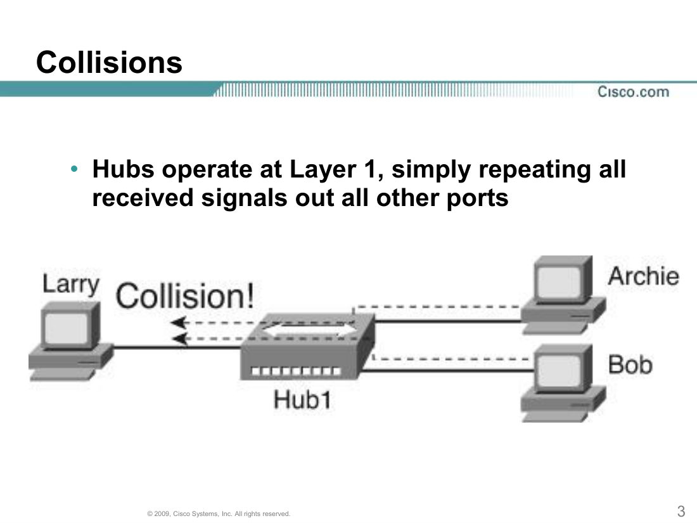

### 1.2 Collision Domain 例子（slide 4）
| 圖 | 說明 |
|---|---|
| **Shared Access is a Collision Domain** | 一條 bus 上所有機 = 1 個 collision domain |
| **Collision Domain – Extended by Repeater** | 兩條 bus 用 repeater 連埋 = **仍然 1 個（更大）** collision domain |
| **Collision Domain – Created by hub** | Hub 加所有接住佢嘅機 = 1 個 collision domain |
| **Collision Domain – Extended by Repeater**（hub + repeater） | 經 repeater 接出去嘅機都係同一個 collision domain |

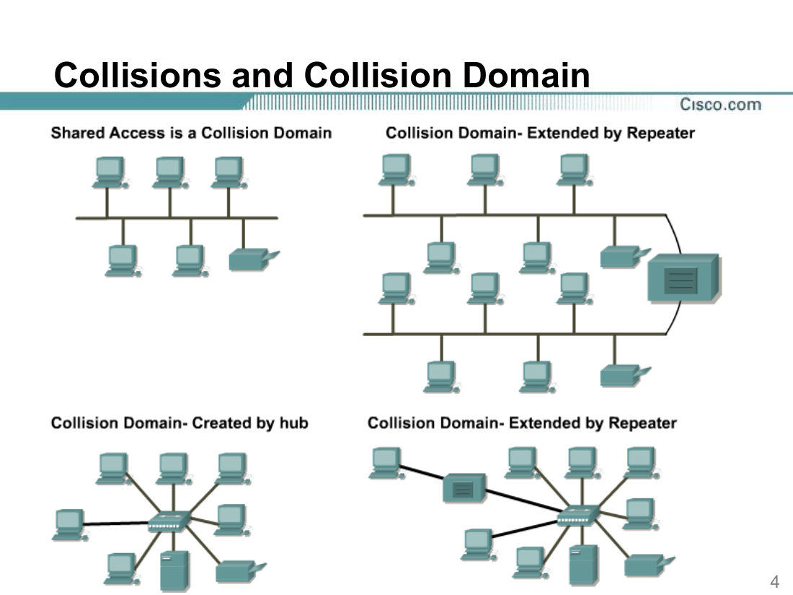

### 1.3 Collision Domains with a Switch（slide 5）
- Switch 接 Fred、Barney、Wilma、Betty → **每個 switch port = 1 個 collision domain → 共 4 個**。

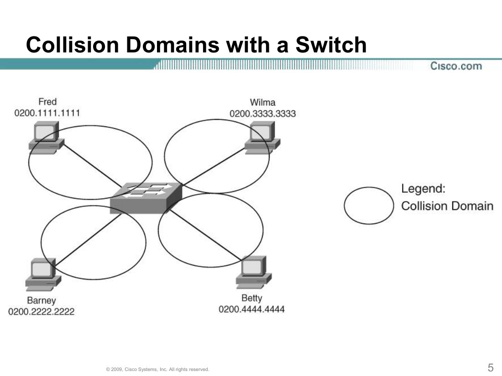

---

## 2. Collision Domains and Full Duplex（slide 6）⭐

- **Each port of a switch creates its own collision domain.**
- **A frame in one collision domain does not cause collisions in another collision domain.**
- **The switch's buffering process prevents the collisions.**
- **When full duplex is enabled:**
  - **NICs/Interfaces can send and receive at the same time.**
  - **CSMA/CD is no longer needed as collisions can't occur.**
  - **Full duplex cannot be used if a hub is plugged into the port.**

> 📖 補充：**CSMA/CD = Carrier Sense Multiple Access with Collision Detection** —— 舊式 **half-duplex shared Ethernet**（bus / hub）用嘅規則：傳送前先「聽」條線有冇人用（carrier sense），多部機共用（multiple access），發現撞車（collision detection）就停低、等隨機時間再試。Full duplex 冇 collision，所以唔再需要。
>
> 🗣️ **Half duplex** = 同一時間只可以 send **或** receive（單線）；**Full duplex** = **同時 send 同 receive**（雙線）。Hub 只支援 half duplex。

> 🎯 **Review Q3**：PC—**Hub**—Router—**Switch**—PC/PC。邊啲 segments **free of collisions**？
> - Segment 1（PC–hub）、Segment 2（hub–router）：有 hub → 同一個 collision domain、half duplex → **可能 collision**。🗣️「**見到 hub 就係 bad news**」
> - Segment 3（router–switch）、Segment 4、5（switch–PC）：**one port, one device + full duplex** → **collision-free**
> - ✅ 答案：**Segments 3, 4, and 5**

---

## 3. ⭐⭐ 唔同 Layer 嘅 Device 對 Collision Domain 嘅影響（教授必考！）

🗣️ 教授：「考試我會問：用咗 layer X device 之後，**possibility / size / number** of collision domains 係 **increase、decrease 定 no change**？」

| Device | **Possibility of collision** | **Size of collision domain** | **Number of collision domains** | 好定壞？ |
|---|---|---|---|---|
| **Layer 1（Hub、Repeater）**（將兩個 segments 接埋） | ⬆️ **Increase** | ⬆️ **Increase** | ⬇️ **Decrease**（例：2 → 1） | ❌ **Bad news** |
| **Layer 2（Switch、Bridge）** | ⬇️ **Decrease** | ⬇️ **Decrease** | ⬆️ **Increase**（例：1 → 2） | ✅ Good |
| **Layer 3（Router）** | ⬇️ **Decrease** | ⬇️ **Decrease** | ⬆️ **Increase**（每個 interface 一個） | ✅ Good |

- 🗣️ **點解 Layer 2/3 會減少 collision？因為 FILTERING！** 例：大 segment 中間放 switch（table 完整）：A → C（同一邊）switch **filter**，唔會傳去另一邊；D → F 亦一樣 → 兩邊可以同時傳 → 冇 collision。
- 🗣️ Layer 1 例子：A-B-C 同 G-…-L 原本係兩條分開嘅線（2 個細 collision domains，A→C 同 G→I 同時傳冇問題）；為咗傳遠啲用 **hub / repeater** 接埋 → 變 **1 個大 collision domain**，A→C 同 G→I 同時傳就會撞。
- 🗣️ **Improper use of hub**：如果將 hub 放喺本身已經係同一 segment 嘅位置（根本唔需要）→ **No change**。
- **Repeater 加喺一條 segment 上** → collision domain **size 增加**（延長咗）。

---

## 4. Collision Domain Segmentation（分割）

- **Breaking up or increasing the number of collision domains with layer 2 and 3 devices is known as segmentation.**

| OSI Layer | 效果 |
|---|---|
| **Network (L3)** | **Break up collision domain** |
| **Data Link (L2)** | **Break up collision domain** |
| **Physical (L1)** | **One collision domain**（唔會分割） |

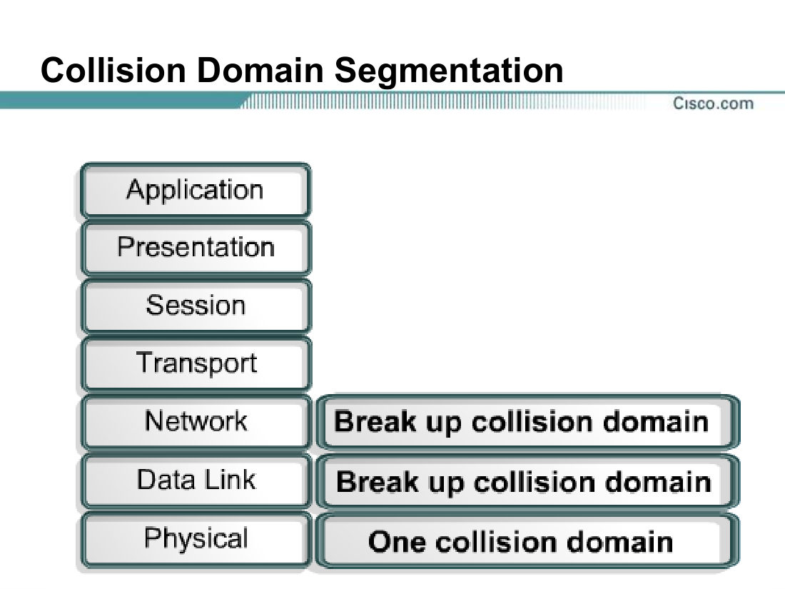

- **Segment collision domains 嘅 devices：Switch、Bridge、Router**（L2 + L3）。
- 🗣️ 計 collision domains = **數 Layer 2 + Layer 3 devices 嘅 interfaces（唔同 interface 各算一個）**。

> 🎯 **Review Q1 / Q19**：邊啲 devices 會 **create multiple collision domains**？→ **Switch 同 Router**（NIC、hub、repeater ❌）
> 🎯 **Review Q18**：邊啲 devices **primarily** 用嚟 **extend cable segments within a collision domain by regenerating the data signals**？→ **Repeater 同 Hub**
> 🗣️ 解題：「所有 network devices 都會 regenerate；所以要 underline **"within a collision domain"**（= 唔分割 collision domain）同 **"primarily"**（主要功能就係 regenerate）→ 只有 Layer 1。」
> 🎯 **Review Q5**：Host A、B 距離超過線材標準，用邊兩個 **physical layer** devices？→ **Hub 同 Repeater**。🗣️ underline「**physical layer**」。

---

## 5. ⭐⭐⭐ 教授嘅「系統化數 Collision Domains」方法（考試照用！）

> 🗣️「Follow this process in your exam, you will never make mistakes.」

**Step 1：Tick ✔ 所有 Layer 2 同 Layer 3 devices**（**Switch、Bridge、Router**）。Hub、Repeater、PC、Server 唔 tick。

**Step 2：揀第一部有 tick 嘅 device，逐個 interface 行：**
- 由呢個 interface 出發，沿住條線一直行（**經過 hub / repeater / 共用 bus 都繼續行**）……
- 直到**行到盡頭**，或者**撞到另一部有 tick 嘅 device** 就停 → 呢段範圍 = **1 個 collision domain**，圈起佢、寫個編號。

**Step 3：嗰部 device 所有 interfaces 做完 → 打 ✗**。去下一部有 tick 嘅 device，**已經數過嘅 interface（同一條線）唔好再數**。

**Step 4：全部做完，最大嗰個編號就係答案。**

> 💡 **快速版**：Collision domains 數目 = **每條「被 L2/L3 device 分隔」嘅線段數目**。
> - 每條 switch/bridge/router ↔ 任何嘢 嘅直接連線 = 1 個
> - 一個 hub（連埋佢所有 ports 上嘅機，加埋佢上面接嘅 L2/L3 port）= 合共 1 個
> - 兩部 tick device 之間嘅連線（例如 switch–router、router–router serial）= 1 個（只數一次！）
> - **FDDI / Token Ring** 當係「一條連續嘅線、冇 device」→ 1 個
> - Router ↔ Internet（WAN serial）= 1 個

### 5.1 課堂大圖：Collision Domain Segmentation（答案 = **15**）⭐
裝置：Router 2（接 Internet + FDDI）、Router 1（F0 → FDDI、T0 → Token Ring、E0 → Main Switch、E1 → bus）、Main Switch、Workgroup Switch、Hub、Repeater、Bridge。

| # | Collision domain |
|---|---|
| 1 | Router 2 ↔ **Internet**（serial） |
| 2 | Router 2 ↔ **FDDI** ↔ Router 1 (F0) |
| 3 | Router 1 (T0) ↔ **Token Ring**（H、J、I） |
| 4 | Router 1 (E1) ↔ L、K ↔ **Repeater** ↔ N、M ↔ Bridge（repeater 唔分割！） |
| 5 | Router 1 (E0) ↔ Main Switch |
| 6 | Bridge ↔ P、O |
| 7 | Main Switch ↔ Main Server |
| 8 | Main Switch ↔ G |
| 9 | Main Switch ↔ Workgroup Switch |
| 10 | Main Switch ↔ **Hub** ↔ A、B、C（成個 hub 一個） |
| 11–15 | Workgroup Switch ↔ F、E、D、printer、server（各一個） |

**→ 15 collision domains；5 broadcast domains**（見第 7 節）

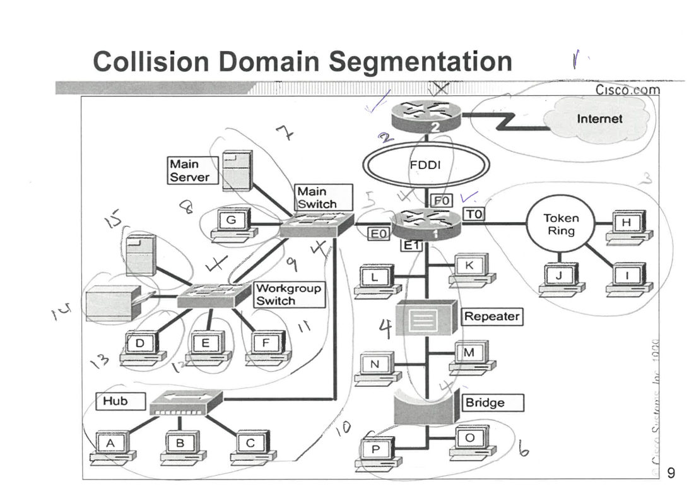

---

## 6. Layer 2 Broadcasts

- **When a node needs to communicate with all hosts on the network, it sends a broadcast frame with a destination MAC address 0xFFFFFFFFFFFF.**
- **Layer 2 devices must flood all broadcast.**
- **The accumulation of broadcast traffic from each device in the network is referred to as broadcast radiation.**（廣播輻射）

### 6.1 Broadcasts in a Bridged Environment（slide 11）
- **A broadcast is picked up by all stations. A broadcast is also forwarded across all bridges whether the receiving host is on the other side of the bridge or not. This eliminates the benefits of having a bridged network.**

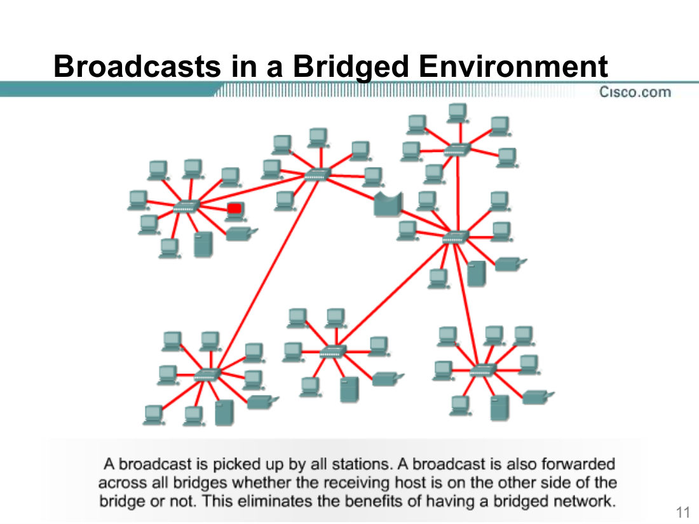

### 6.2 Broadcast Domain Segmentation（slide 12）
- **By using a router in place of a bridging device a layer two broadcast is contained. Layer three devices are the only devices that contain broadcasts.**

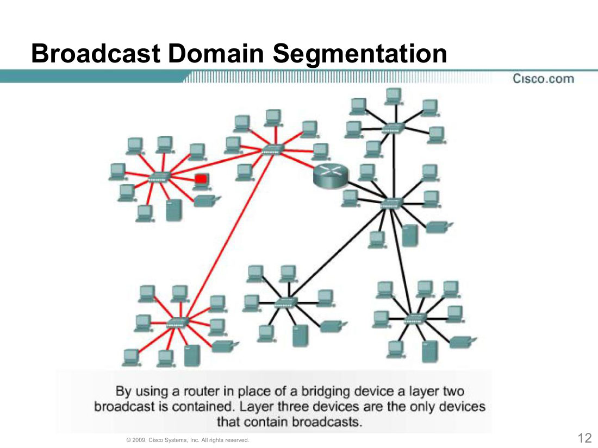

---

## 7. ⭐⭐ Broadcast Domain

- 🗣️ 教授定義：**When a device sends a broadcast message, the area where it goes** = broadcast domain。
- Slide 定義：**A broadcast domain is a grouping of collision domains that are connected by Layer 2 devices.**
- **Broadcasts are forwarded by Layer 2 devices and if excessive, can reduce the efficiency of the entire LAN.**
- **Broadcasts have to be controlled at Layer 3, as Layer 2 and Layer 1 devices have no way of controlling them.**
- 🗣️ 問題：broadcast domain 太大 → 一部機 broadcast 時，**其他機要等佢完先可以通訊** → 要用 **router** 拆細。
- 🗣️ **Router 唔 forward broadcast（routers filter broadcasts / never flood）** → broadcast 去到 router 就停。

### 7.1 數 Broadcast Domains 方法
- **只 tick Router（Layer 3）**，然後用同樣方法：由每個 router interface 行出去，直到盡頭或撞到另一部 router。
- 🗣️ 快速：**Broadcast domains 數目 = router 嘅（唔同）interfaces 數目**（兩部 router 之間嘅連線只數一次）。
- **如果成幅圖冇 router → 只有 1 個 broadcast domain。**

### 7.2 總結（🗣️ "summarize everything"）
> - **Separate broadcast domains：只有 Router（Layer 3）**
> - **Separate collision domains：Layer 2（Switch、Bridge）同 Layer 3（Router）**
> - **Layer 1（Hub、Repeater）：兩樣都唔分隔**

---

## 8. ⭐⭐⭐ Collision Domains and Broadcast Domains 對照表（slide 14，必背）

| Device | **Highest Layer at Which It Operates** | **Separates LAN into Multiple Collision Domains on Each Interface** | **Separates LAN into Multiple Broadcast Domains on Each Interface** |
|---|---|---|---|
| **Repeater** | **1** | **No** | **No** |
| **Hub** | **1** | **No** | **No** |
| **Bridge** | **2** | **Yes** | **No** |
| **Switch** | **2** | **Yes** | **No** |
| **Router** | **3** | **Yes** | **Yes** |

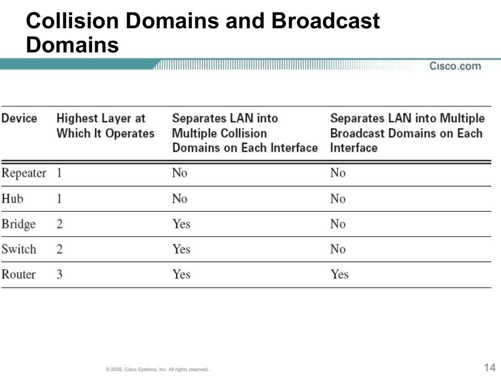

---

## 9. ⭐ 官方 Review 題目計數詳解

### Q2（答案：**7 collision domains**；broadcast = 3）

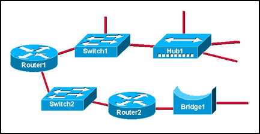

圖：Router1 —— Switch1（Switch1 接 1 部 host + Hub1；Hub1 接 3 部 host）；Router1 —— Switch2 —— Router2 —— Bridge1 —— 一條 segment。
1. Router1 ↔ Switch1
2. Switch1 ↔ host
3. Switch1 ↔ Hub1（+ Hub1 嘅 3 部 hosts）
4. Router1 ↔ Switch2
5. Switch2 ↔ Router2
6. Router2 ↔ Bridge1
7. Bridge1 ↔ 右邊 segment
→ **7**。Broadcast：Router1 兩個 interfaces（Switch1 邊、Switch2 邊）+ Router2 另一個 interface（Bridge 邊；Switch2 邊同 Router1 共用）→ **3**。

### Q4（答案：**3 broadcast domains**；collision = 7）

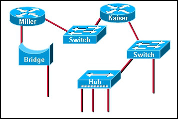

圖：Miller router —— Bridge —— segment；Miller —— Switch —— Kaiser router —— Switch —— (host + Hub with 3 hosts)。
- Broadcast：① Miller ↔ Bridge 邊 ② Miller ↔ Switch ↔ Kaiser（同一個）③ Kaiser ↔ 右邊 Switch / Hub → **3**
- Collision：Miller–Bridge、Bridge–segment、Miller–Switch、Switch–Kaiser、Kaiser–Switch、Switch–host、Switch–Hub(+3 hosts) → **7**

### Q3（答案：**Segments 3, 4, 5** collision-free）—— 見第 2 節。

### Q8（Broadcast 去咗邊）

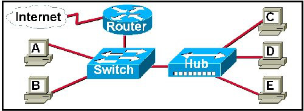

Router（接 Internet）—— Switch —— A、B、Hub（C、D、E）。A 送 broadcast → switch flood（B、router、hub）→ hub flood（C、D、E）→ **router 唔會 forward 去 Internet** → **B, C, D, E 同 router 收到**。
- 呢幅圖：collision domains = 5（Router–Internet、Router–Switch、Switch–A、Switch–B、Switch–Hub+C/D/E）；broadcast domains = 2。

### Q16（Switch 已 built CAM table）

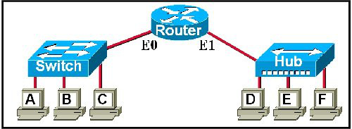

Switch（A、B、C）—— Router E0；Router E1 —— Hub（D、E、F）。A → C unicast → **只有 C** 收到。
- 呢幅圖：collision domains = 5（A、B、C、Switch–E0、E1–Hub+D/E/F）；broadcast domains = 2。

### Q20：大量 broadcast traffic 令網絡慢 → **Router**
### Q22：Segment a network → **Switches、Routers、Bridges**

---

## ✅ Module 3 Part II 快速自測

1. 邊啲 devices 分隔 **collision** domains？→ **Switch、Bridge、Router**
2. 邊啲 devices 分隔 **broadcast** domains？→ **只有 Router**
3. 加 hub 將兩條 segment 接埋：possibility / size / number？→ **↑ / ↑ / ↓**
4. 加 switch 將一條大 segment 分開：possibility / size / number？→ **↓ / ↓ / ↑**（因為 **filtering**）
5. Full duplex 開咗之後仲使唔使 CSMA/CD？→ **唔使**（collisions can't occur）；**接 hub 嘅 port 用唔到 full duplex**
6. Broadcast radiation 係乜？→ **Accumulation of broadcast traffic from each device**
7. Broadcast domain 定義（slide）？→ **A grouping of collision domains connected by Layer 2 devices**
8. 一部 switch 接 8 部 PC，冇 router：collision / broadcast domains？→ **8 / 1**
9. 一部 router 有 3 個 interfaces，每個接一部 switch，每部 switch 接 4 部 PC：collision / broadcast？→ **3 + 12 = 15 / 3**
